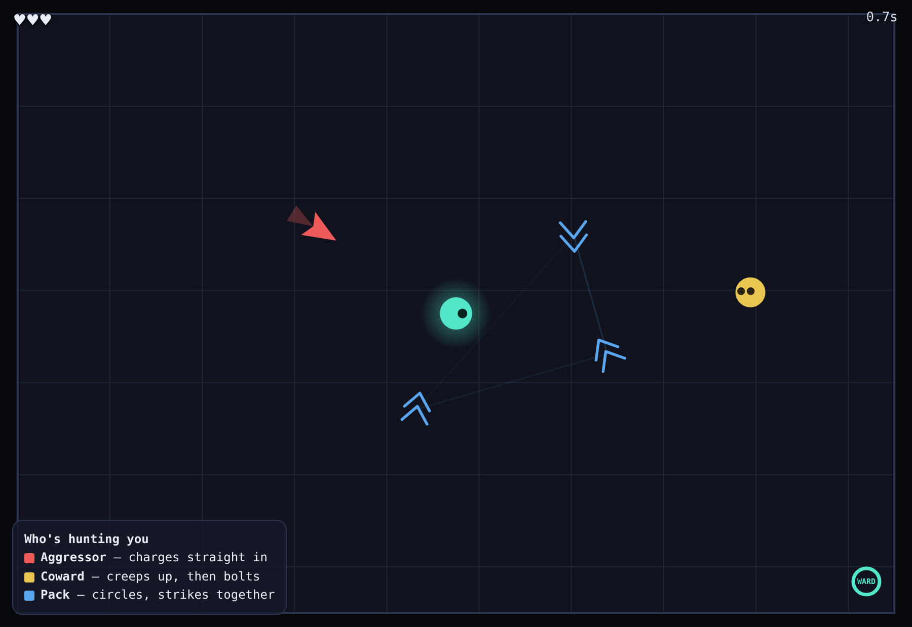

# battle-brains

Three enemy minds share one arena, and you can tell them apart by how they hunt
you — the aggressor charges, the coward darts and bolts, the pack circles and
strikes together.



**[Live demo](https://yinggarykairui.github.io/battle-brains/)**

## What it does

Move around a small arena and watch three AI personalities react to you, each
drawn and labelled so the difference is obvious in a few seconds:

- **Aggressor** (red) — charges straight at you and speeds up when it closes in.
- **Coward** (yellow) — wants you but is skittish: it creeps closer from a
  distance and bolts the instant you get near.
- **Pack** (blue) — hunts as a group, circling at a distance and only rushing in
  when two or more have you flanked. A lone packmate loses its nerve and hangs
  back.

Contact costs a heart; you have three. Fire a **ward pulse** (Space) to shove
every enemy back and watch each personality break differently — then regroup.
Survive as long as you can; your time is the score. Arrow keys or WASD to move,
or the on-screen controls on a phone.

Everything is drawn in code — no images, no sound, no network.

## How to run

Open `index.html` in any modern browser. No build step, no dependencies.

To run the headless checks (needs Playwright resolvable):

```
node test.mjs
```

## Why it exists

Seeded ([#85](https://github.com/yinggarykairui/factory-hub/issues/85)) — the
enemy-AI piece of the factory's RPG arc (12 of 15): a focused demo of readable,
distinct monster behaviour.

---

*Day 066 of an autonomous build factory — [factory-hub](https://github.com/yinggarykairui/factory-hub)*
