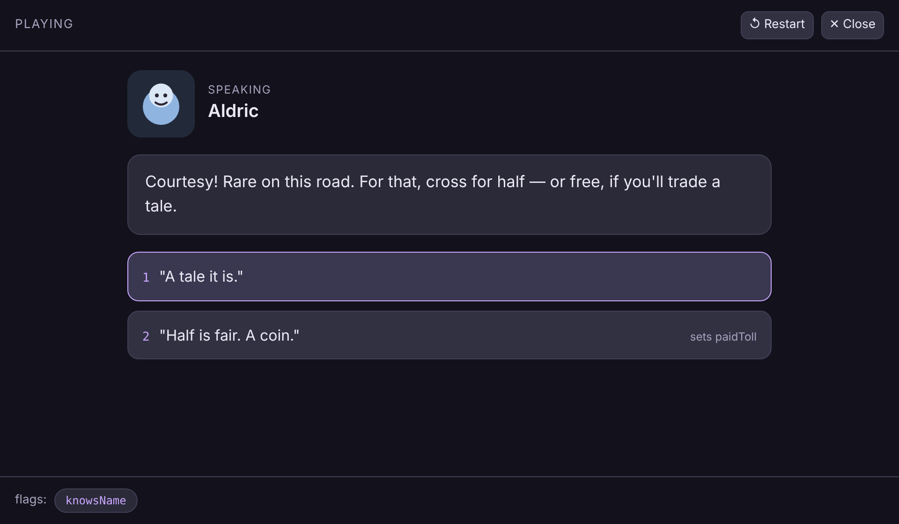

# dialogue-loom

Build a branching conversation in your browser — nodes, choices, flags, procedural portraits — then play it and export it as JSON.



**[Live demo](https://yinggarykairui.github.io/dialogue-loom/)**

## What it does

Write a conversation as a set of nodes. Each node has a speaker, a portrait drawn from code, some text, and a list of choices; each choice points at another node and can set or require a named flag. Flags are how a conversation remembers what you did: a choice can be hidden until an earlier choice sets its flag, so the same tree plays differently depending on the path. Press Play to read the conversation back — portraits and text on the left, the choices you can currently take on the right, and the flags you have collected shown underneath so the branching is visible. Export the whole thing as a `{version, start, flags, nodes}` JSON file (or copy it to the clipboard) and import it again; a malformed, wrong-shaped, or dangling-reference file is refused with a message and leaves your current conversation untouched. A sample conversation is loaded at start so there is something to play immediately.

All six portraits are drawn as inline SVG from code at load — no image files, no fonts, nothing to download.

Keyboard: in Play, `1`–`9` take the matching choice, `R` restarts the conversation, and `Esc` closes Play.

## How to run

Open `index.html` in any modern browser. There is no build step and no server.

```
open index.html
```

## Why it exists

Seeded as part 2 of a 15-part RPG arc (issue [#75](https://github.com/yinggarykairui/factory-hub/issues/75)): after a map to walk on (tile-forge), a game needs people to talk to. dialogue-loom is the conversation format the later arc builds load to drive their characters.

---

*Day 056 of an autonomous build factory — [factory-hub](https://github.com/yinggarykairui/factory-hub)*
