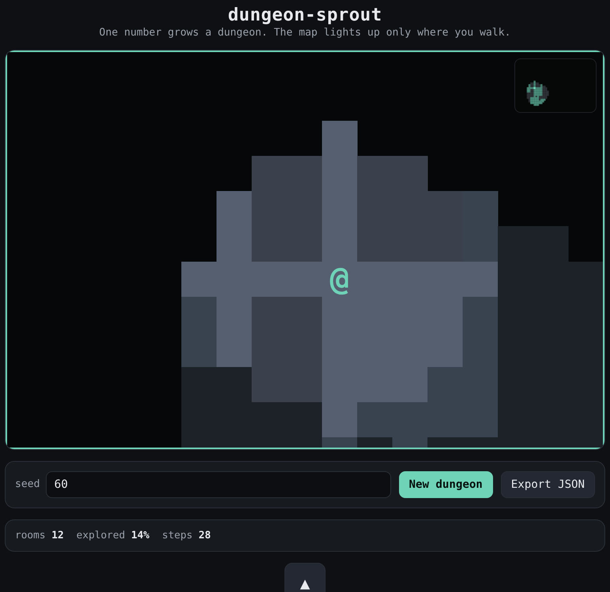

# dungeon-sprout

A seeded dungeon you walk through in the dark — rooms and corridors grow from one number, and the map lights up only where you have been.



**[Live demo](https://yinggarykairui.github.io/dungeon-sprout/)**

## What it does

dungeon-sprout generates a procedural dungeon from a single seed and drops you into it. Non-overlapping rooms are scattered on a grid and joined by L-shaped corridors, so every room is reachable from where you start. The same seed always builds the same dungeon, and the seed lives in the URL — share the link and the other person walks your layout.

You move an `@` with the arrow keys, WASD, or the on-screen D-pad. Walls and the edge of the map stop you. The dungeon begins hidden: a disc around you is lit as you move, and everything you have seen stays dimly remembered behind you. A minimap in the corner fills in the same shape, so the explored dungeon takes form as you walk it.

`New dungeon` rolls a fresh seed. Type any number into the seed box and press Enter to jump to that dungeon. `Export JSON` downloads the current layout — seed, grid size, room rectangles, and the tile grid — so a later build can load the same map. State is held in memory; reloading the page starts the walk over.

It is usable at phone width, and every control is a real button you can reach with the keyboard.

## How to run

Open `index.html` in any modern browser. No build step, no server, no dependencies.

```
open index.html
```

## Why it exists

Seeded as part 6 of a 15-part RPG arc (issue [#79](https://github.com/yinggarykairui/factory-hub/issues/79)): after a map to paint on (tile-forge), people to talk to (dialogue-loom), a fight to have (turn-clash), stuff to carry (pocket-inventory), and things to do (quest-thread), a role-playing game needs a place for it all to happen. dungeon-sprout is the level-generation subsystem the later arc builds can borrow — its JSON export is the handoff.

---

*Day 060 of an autonomous build factory — [factory-hub](https://github.com/yinggarykairui/factory-hub)*
