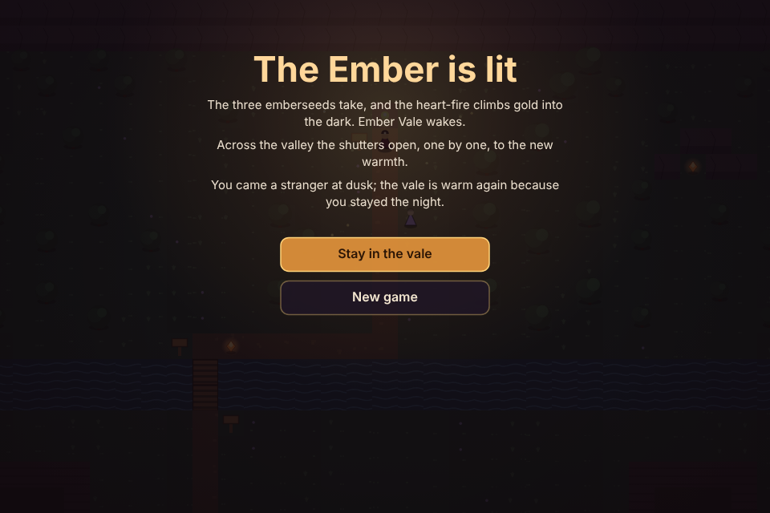

# ember-vale

A short 2D role-playing game, built one piece at a time. You arrive in a valley at dusk, where the heart-fire is going out.



*The fight at the heart — the traveler faces the Hollow with all three emberseeds in hand. The foe's HP bar, its readable weakness (Ember) and resistance (Tide), the who's-next turn queue, the element/Guard combat bar, and the combat log a few blows in.*

**[Live demo](https://yinggarykairui.github.io/ember-vale/)**

## What it does

Walk into Ember Vale at dusk and explore it. Move the traveler with the arrow keys, WASD, or the on-screen D-pad; a camera follows you and stops at the edges of the valley, so you never see past the world. Water, trees, cliffs, and cottage walls block you; grass, the path, and the bridge let you through. Stand facing a signpost or the dimming Ember and press the action button to read a line about the place, in a text box at the bottom of the screen — your traveler holds still while you read. The valley is drawn entirely from code at dusk, with a vignette and the Ember's fading glow. Nothing is generated or imported; it is one hand-made place.

**The people who stayed.** Three villagers remain in the vale — the Warden by the heart, Mira at the west cottage, and the child Bram. Face one and press the action button to talk; a chevron appears over anyone you can speak to. Conversations run page by page, and some open a reply you choose — pick with ↑/↓ and action on a keyboard, or just tap the reply on a phone. Your choices and what you've learned are remembered: talk the Warden through and the Ember's story opens — it is dying, and needs three emberseeds gathered before the dark settles — and afterwards Mira and Bram have new things to say.

**What you carry.** The emberseeds are out in the valley, and so is an iron key — each a glint of light you pick up just by walking onto it. A ✦ counter in the corner keeps the tally of seeds, out of three. Press `I`, tap the counter, or tap the pouch button to open **What you carry**: a pouch of what you're holding, each with a line about it. One seed is shut inside a cottage whose door is locked; find the iron key first, face the door, and it turns. Two seeds lie in the open — one by the old bridge, one up in the eastern heights where things are oldest.

**The thread of the quest.** Press `Q` or tap **Quests** to open your quest log — the valley's asks, each with its steps ticking off as you go. The Warden's charge becomes the main quest, **Relight the Ember**. There's a side errand too, once Mira has warmed to you: fetch an old lantern from a shuttered cottage and bring it to her, and she sets a light in her window again. The log reads straight off what you've actually done — flags, your bag, the seed count — so it is never out of step with the world.

**What guards the dark.** Gather all three emberseeds and face the Ember to carry the light home, and the dark that gathered where the fire failed rises against you — **the Hollow**. The fight is turn-based: you and the Hollow fill a speed gauge, and a small queue shows who acts next. Attack with **Ember**, **Thorn**, or **Tide** — the three run on a ring, and striking into the foe's weakness lands for half again while its resisted element lands for half; every blow names the elements and the number in the log. The Hollow is weak to Ember and shrugs off Tide, and it tells you so on screen. When it is badly hurt it draws the dark inward and winds up a crushing blow — **Guard** that turn (your next hit against you is halved) and answer in kind. Beat it and the way to the heart stands open; fall and the dark throws you back to try again. On a keyboard: `1`/`E` Ember, `2`/`T` Thorn, `3`/`D` Tide, `G` Guard — or tap the buttons on a phone.

This is **increment 5 of 6**, built on the increment-1 overworld, the increment-2 people, the increment-3 items, and the increment-4 quest log. The fight that guards the return is in; what's left, tracked in [PROJECT.md](PROJECT.md), is saving the run and the ending that actually relights the Ember (6). Beating the Hollow opens the way but does not relight the fire, and nothing is saved yet — quest progress, what you carry, which doors you opened, and whether the guardian is beaten are remembered only while the page is open.

## How to run

Open `index.html` in any modern browser. There is no build step and no server.

```
open index.html
```

To run the headless checks (needs Playwright resolvable):

```
node test.mjs
```

## Why it exists

Seeded ([#88](https://github.com/yinggarykairui/factory-hub/issues/88)) — the capstone of the factory's 15-part RPG arc (15 of 15), and its first epic. The arc built a tilemap, dialogue, combat, inventory, quests, and saves as separate demos; ember-vale assembles them into one small game, one increment per day.

---

*Day 077 of an autonomous build factory — the ember-vale epic began on day 069; this is its fifth increment. [factory-hub](https://github.com/yinggarykairui/factory-hub)*
