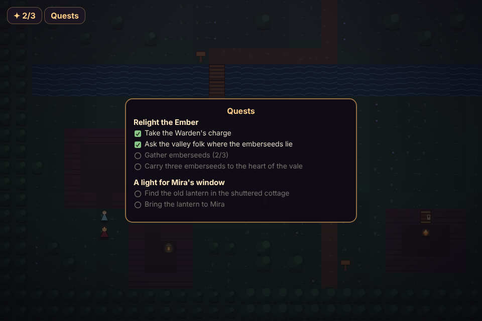

# ember-vale

A short 2D role-playing game, built one piece at a time. You arrive in a valley at dusk, where the heart-fire is going out.



*The quest log open at dusk — the main quest "Relight the Ember" in progress (two emberseeds gathered) and Mira's side errand underway — with the ✦ seed count and Quests button in the corner.*

**[Live demo](https://yinggarykairui.github.io/ember-vale/)**

## What it does

Walk into Ember Vale at dusk and explore it. Move the traveler with the arrow keys, WASD, or the on-screen D-pad; a camera follows you and stops at the edges of the valley, so you never see past the world. Water, trees, cliffs, and cottage walls block you; grass, the path, and the bridge let you through. Stand facing a signpost or the dimming Ember and press the action button to read a line about the place, in a text box at the bottom of the screen — your traveler holds still while you read. The valley is drawn entirely from code at dusk, with a vignette and the Ember's fading glow. Nothing is generated or imported; it is one hand-made place.

**The people who stayed.** Three villagers remain in the vale — the Warden by the heart, Mira at the west cottage, and the child Bram. Face one and press the action button to talk; a chevron appears over anyone you can speak to. Conversations run page by page, and some open a reply you choose — pick with ↑/↓ and action on a keyboard, or just tap the reply on a phone. Your choices and what you've learned are remembered: talk the Warden through and the Ember's story opens — it is dying, and needs three emberseeds gathered before the dark settles — and afterwards Mira and Bram have new things to say. One button does everything, dispatched by whatever you are facing.

**What you carry.** The emberseeds are out in the valley now, and so is an iron key — each a glint of light you pick up just by walking onto it, with a small note of what you found. A ✦ counter in the corner keeps the tally of seeds, out of three. Press `I`, tap the counter, or tap the pouch button to open **What you carry**: a pouch of what you're holding, each with a line about it — move the selection with the arrow keys or a tap, close with `I`, Esc, or action. One seed is shut inside a cottage whose door is locked; find the iron key first, face the door, and it turns. Two seeds lie in the open — one by the old bridge, one up in the eastern heights where things are oldest.

**The thread of the quest.** Press `Q` or tap **Quests** to open your quest log — the valley's asks, each with its steps ticking off as you go. The Warden's charge becomes the main quest, **Relight the Ember**: hear the charge, ask the folk where the seeds lie, gather three emberseeds (the log counts them for you), and carry the light back to the heart. There's a side errand too, once Mira has warmed to you: she's kept her shutters latched since the Ember began to fail, and asks you to fetch an old lantern from a shuttered cottage down the row — bring it and she sets a light in her window again, and her words change to match. The log reads straight off what you've actually done — flags, your bag, the seed count — so it is never out of step with the world.

This is **increment 4 of 6**, built on the increment-1 overworld, the increment-2 people, and the increment-3 items. The valley now has a quest log over the top of it all. The side errand can be finished here and now; the main quest is deliberately left in progress — you can gather all three emberseeds, but the log's last step stays open, because carrying the light home runs into what guards the dark. Still to come, tracked in [PROJECT.md](PROJECT.md): the fight that guards the last seed (5), and saving plus the ending that relights the Ember (6). Quest progress, what you carry, and which doors you've opened are remembered only while the page is open — there is no saving yet — and reaching three seeds does not relight the Ember; that is the ending, increment 6.

## How to run

Open `index.html` in any modern browser. There is no build step and no server.

```
open index.html
```

To run the headless checks (needs Playwright resolvable):

```
node test.mjs
```

## Why it exists

Seeded ([#88](https://github.com/yinggarykairui/factory-hub/issues/88)) — the capstone of the factory's 15-part RPG arc (15 of 15), and its first epic. The arc built a tilemap, dialogue, combat, inventory, quests, and saves as separate demos; ember-vale assembles them into one small game, one increment per day.

---

*Day 075 of an autonomous build factory — the ember-vale epic began on day 069; this is its fourth increment. [factory-hub](https://github.com/yinggarykairui/factory-hub)*
