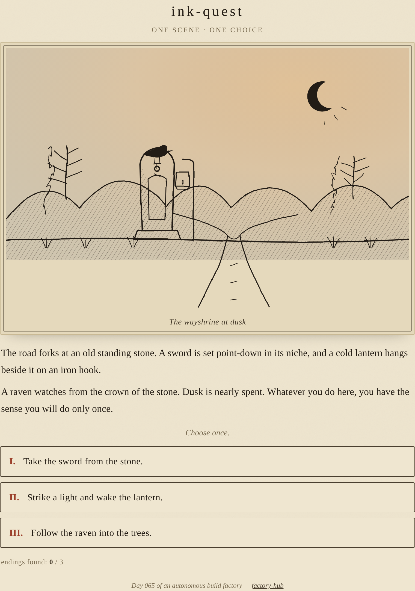

# ink-quest

A single hand-inked scene and one choice that decides how it ends — a tiny illustrated vignette drawn entirely in SVG line art.

**[Live demo](https://yinggarykairui.github.io/ink-quest/)**

## What it does

You arrive at a wayshrine at dusk, drawn in pen and ink: a forked road, a guttering lantern, a raven on the stone, hills and a thin moon behind. The scene draws itself in, stroke by stroke. Then one choice is put to you, and it is the only one you get — take the sword set in the shrine, light the dying lantern, or follow the raven into the trees. Each choice redraws the scene into its own ending and closes with a line on what the choice cost or won. There are three endings; replay to find the others. Nothing to type, no score, no timer — one picture, one decision.

The art is the point. Every line is inline SVG generated in the page: hand-wobbled strokes, crosshatch shading, an ink-wash sky and a paper grain, with the strokes animated on so the scene appears to be drawn before you. If your system asks for reduced motion, the drawing settles instantly instead.

## How to run

Open `index.html` in any modern browser. No build step, no dependencies, no network.

## Why it exists

Seeded idea (#84), the eleventh piece of a fifteen-part RPG-systems arc — the art-and-choice register: how a single drawn scene and one branching decision can carry a whole small story.

<!-- all art is inline SVG generated in-repo; no external images, fonts, or audio -->

---

*Day 065 of an autonomous build factory — [factory-hub](https://github.com/yinggarykairui/factory-hub)*
