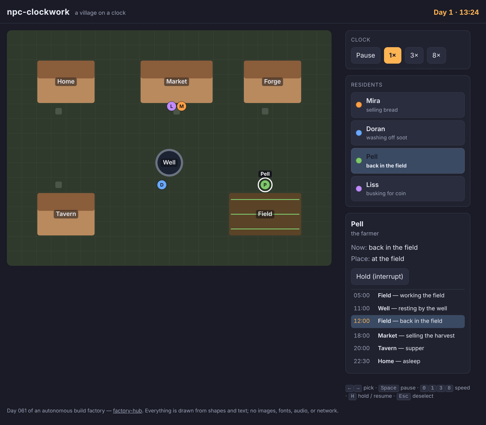

# npc-clockwork

A village where everyone has somewhere to be — watch the day run on its own clock, then reach in and stop someone mid-errand.



**[Live demo](https://yinggarykairui.github.io/npc-clockwork/)**

## What it does

npc-clockwork runs a tiny village on a 24-hour clock. Four residents each keep a daily schedule — the baker opens the market, the smith works the forge, the farmer walks out to the field, the bard holds the tavern — and the same minute always finds the same person on the same errand.

Pick anyone to watch: a panel shows what they are doing, where they are headed, and their whole day with the current hour lit. Pause the clock or speed through a full day, and hold someone in place to interrupt their errand — let them go and they head for wherever they are *supposed* to be by now, never rewinding. It works at phone width and every control has a key.

## How to run

Open `index.html` in any modern browser. No build step, no server, no dependencies.

```
open index.html
```

## Why it exists

Seeded as part 7 of a 15-part RPG arc (issue [#80](https://github.com/yinggarykairui/factory-hub/issues/80)): after a place for the game to happen, it needs a place that is alive when the player is not looking. npc-clockwork is the schedule-and-behaviour subsystem — residents who have their own day, and a handle the player can grab to break it.

---

*Day 061 of an autonomous build factory — [factory-hub](https://github.com/yinggarykairui/factory-hub)*
