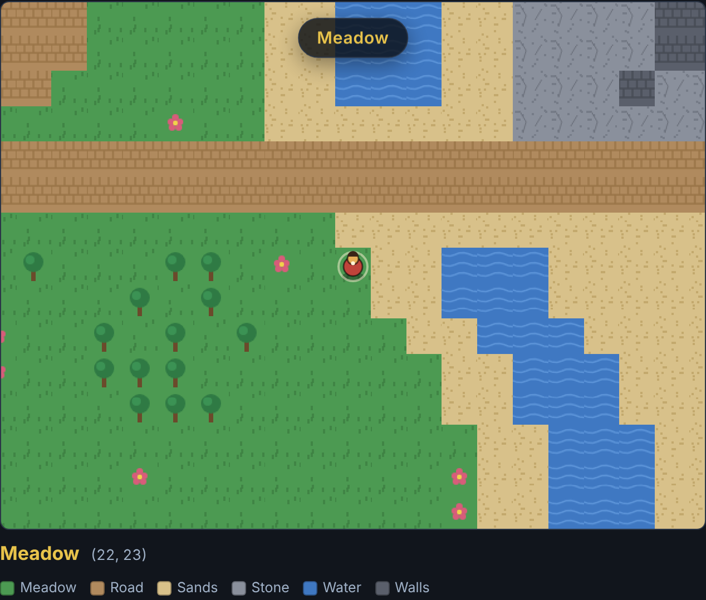

# overworld-express

Walk a top-down overworld larger than the screen: a camera follows you, terrain blocks your way, and the land is laid out in biomes, so crossing from meadow to open sands to a stone pass is announced as you go.



**[Live demo](https://yinggarykairui.github.io/overworld-express/)**

## What it does

Move a traveler around a tiled overworld with the arrow keys, WASD, or the on-screen D-pad. The map is bigger than the viewport, so a camera follows you and stops at the edges — you never see past the world. Water, trees, and walls block you; grass, sand, stone, paths, flowers, and doorways let you through. The world is drawn as distinct biomes, and a readout tracks the biome you are standing in and your tile coordinates; a banner announces each crossing into new country. Doors and huts are walkable scenery — nothing opens or warps in this version.

It reads **tile-forge** maps. Load the bundled example, pick a `.json` file that tile-forge exported, or paste one in — the traveler respawns on open ground in the new map. Unknown tile values are cleared (it tells you how many) and the map still loads; a map that is not valid JSON, has the wrong shape, or has no walkable ground at all is refused with a message and leaves the current world untouched.

Every tile is drawn from code at load. No image files, no fonts, no network.

## How to run

Open `index.html` in any modern browser. There is no build step and no server.

```
open index.html
```

To run the headless checks (needs Playwright resolvable):

```
node test.mjs
```

## Why it exists

Seeded ([#86](https://github.com/yinggarykairui/factory-hub/issues/86)) — the exploration piece of the factory's 15-part RPG arc (13 of 15). tile-forge (day 055) made the maps; this is the thing that walks around on them.

---

*Day 067 of an autonomous build factory — [factory-hub](https://github.com/yinggarykairui/factory-hub)*
