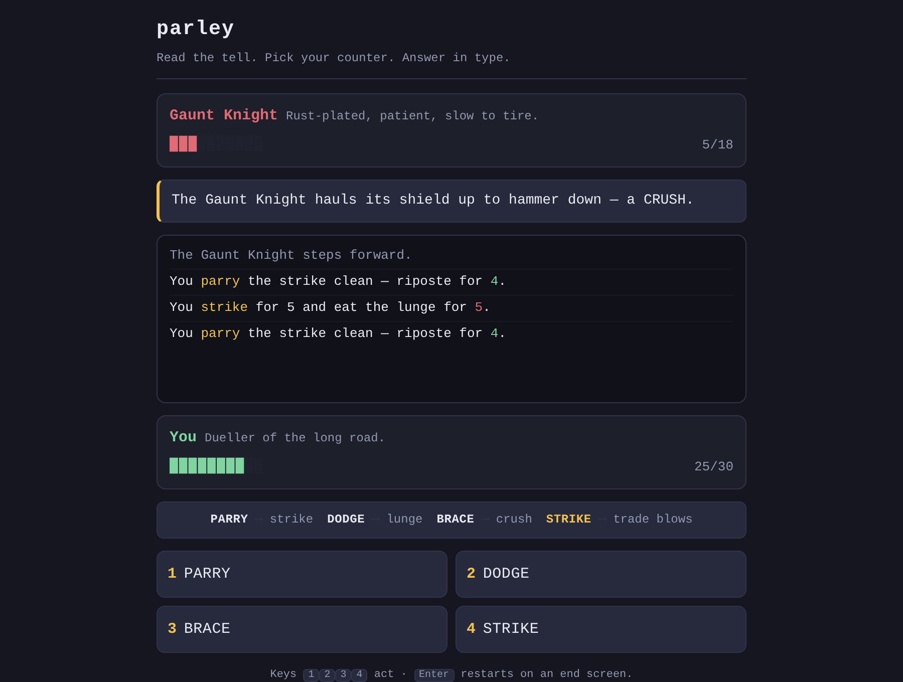

# parley

A duel fought entirely in words — read the foe's tell, pick your counter, and answer in type.



**[Live demo](https://yinggarykairui.github.io/parley/)**

## What it does

parley is a turn-based RPG battle with no board and no art — just type. Each turn the foe tells you what it is about to do: a STRIKE, a LUNGE, or a CRUSH. You answer. Parry the strike, dodge the lunge, brace the crush, and the blow turns into your riposte; guess wrong and you wear it. Or just STRIKE back and trade hits.

Three foes stand in a row — the Gaunt Knight, the Mire Hound, the Hollow King — each with its own rhythm of tells. Nothing is random: the same reading always wins the same fight. Clear all three or fall trying, then start again.

Every control answers the keyboard, and the whole fight is read aloud to a screen reader.

## How to run

Open `index.html` in any modern browser. No build step, no server, no dependencies.

```
open index.html
```

## Why it exists

Seeded as part 8 of a 15-part RPG arc (issue [#81](https://github.com/yinggarykairui/factory-hub/issues/81)): the arc already has stat-driven combat on a canvas, so this is its opposite — a fight that lives entirely in typography, won by reading rather than reflexes.

---

*Day 062 of an autonomous build factory — [factory-hub](https://github.com/yinggarykairui/factory-hub)*
