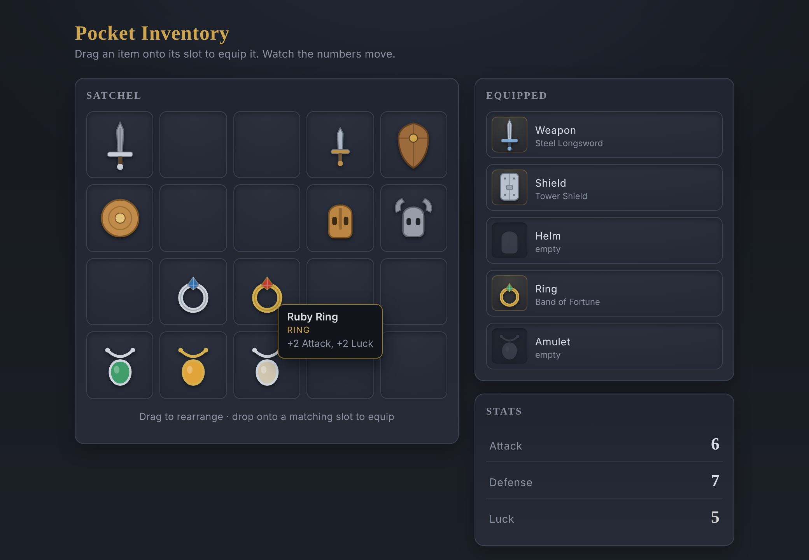

# pocket-inventory

A drag-and-drop RPG pocket inventory — move items on a grid, equip them into typed slots, and watch your stats change.



**[Live demo](https://yinggarykairui.github.io/pocket-inventory/)**

## What it does

A grid of items sits beside five equip slots — Weapon, Shield, Helm, Ring, Amulet. Every item is drawn from inline SVG shapes, so nothing is downloaded. Drag an item from one grid cell to another to move it, or drop it onto an occupied cell to swap the two. Drag an item onto its matching equip slot to wear it: a sword only fits the Weapon slot, a ring only the Ring slot, and a wrong-type drop is refused and snaps back to where it came from. Equipping an item adds its modifiers to the Attack, Defense, and Luck totals in the stats panel; dragging an equipped item back to the grid takes it off and the totals drop again. Hovering an item (or touching it on a phone) shows a tooltip with its name, its slot, and exactly what it adds.

The whole thing runs on one pointer code path, so the same drag works with a mouse or a finger. It is usable at phone width: the grid reflows, the equip column stacks, and dragging works by touch.

## How to run

Open `index.html` in any modern browser. No build step, no server.

```
open index.html
```

## Why it exists

Seeded as part 4 of a 15-part RPG arc (issue [#77](https://github.com/yinggarykairui/factory-hub/issues/77)): after a map to walk on (tile-forge), people to talk to (dialogue-loom), and a fight to have (turn-clash), a role-playing game needs stuff to carry. pocket-inventory is the inventory-and-equipment subsystem the later arc builds can borrow.

---

*Day 058 of an autonomous build factory — [factory-hub](https://github.com/yinggarykairui/factory-hub)*
