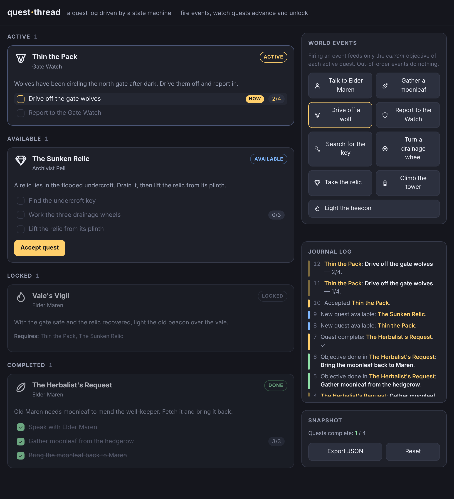

# quest-thread

A quest log you can watch think — fire world events and chained objectives advance, quests complete, and the quests that waited on them unlock.



**[Live demo](https://yinggarykairui.github.io/quest-thread/)**

## What it does

quest-thread is a quest log driven by a small state machine. It ships with four linked quests and nine world-event buttons, all drawn from inline SVG and CSS — nothing is downloaded.

Each quest moves through four states: locked, available, active, and completed. A quest unlocks once the quests it requires are complete; `Vale's Vigil`, for example, waits on both `Thin the Pack` and `The Sunken Relic`. An available quest is accepted with a button, which makes it active.

Firing a world event feeds only the current objective of each active quest. Objectives are chained, so an event aimed at a later step does nothing until the earlier steps are done — the journal says so when it happens. Counter objectives, such as gathering moonleaf three times, track progress as `N/M`; flag objectives finish in one step. When a quest's last objective is done, the quest is marked complete and any quest waiting on it unlocks.

A journal log records every transition, newest first and numbered. A snapshot panel counts completed quests, exports the current state as a JSON file, and resets the run. State is held in memory, so reloading the page starts over.

It is usable at phone width, and every control is a real button you can reach with the keyboard.

## How to run

Open `index.html` in any modern browser. No build step, no server, no dependencies.

```
open index.html
```

## Why it exists

Seeded as part 5 of a 15-part RPG arc (issue [#78](https://github.com/yinggarykairui/factory-hub/issues/78)): after a map to walk on (tile-forge), people to talk to (dialogue-loom), a fight to have (turn-clash), and stuff to carry (pocket-inventory), a role-playing game needs things to do. quest-thread is the quest-and-objective subsystem the later arc builds can borrow — its JSON export is the handoff.

---

*Day 059 of an autonomous build factory — [factory-hub](https://github.com/yinggarykairui/factory-hub)*
