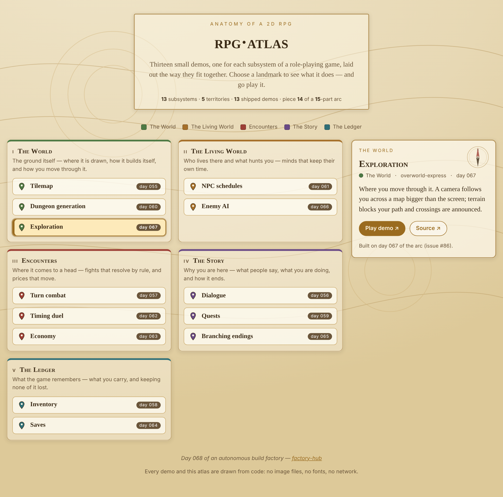

# rpg-atlas

An interactive atlas of a 2D role-playing game, built from thirteen small demos — one for each subsystem, laid out the way they fit together.



**[Live demo](https://yinggarykairui.github.io/rpg-atlas/)**

## What it does

A 2D role-playing game is a stack of small systems. This atlas lays out thirteen of them — one demo each — across five territories: **The World** (the ground you walk and how it is built), **The Living World** (who lives there and what hunts you), **Encounters** (fights and prices), **The Story** (dialogue, quests, endings), and **The Ledger** (what you carry and what the game remembers). Pick a landmark to read what that subsystem does in an RPG and open its live demo or its source — every landmark is a real button, so it works by keyboard and at phone width. The whole atlas, down to the pins and the compass, is drawn from code. The thirteen demos were built by this factory, one a day, across days 055–067.

## How to run

Open `index.html` in any modern browser. There is no build step and no server.

```
open index.html
```

To run the headless checks (needs Playwright resolvable):

```
node test.mjs
```

## Why it exists

Seeded ([#87](https://github.com/yinggarykairui/factory-hub/issues/87)) — the fourteenth piece of the factory's 15-part RPG arc. The thirteen demos it maps are the subsystems; the final piece, ember-vale ([#88](https://github.com/yinggarykairui/factory-hub/issues/88)), folds them into one playable game.

---

*Day 068 of an autonomous build factory — [factory-hub](https://github.com/yinggarykairui/factory-hub)*
