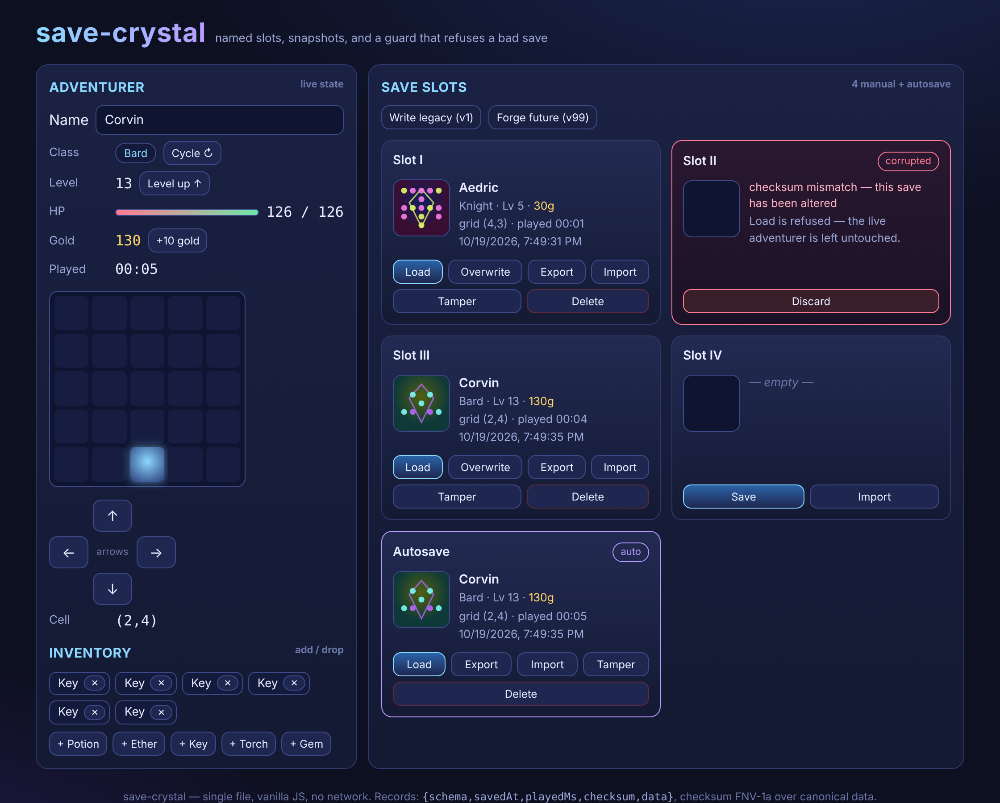

# save-crystal

The save system a 2D RPG actually needs: named slots, snapshots, and a corruption guard that refuses a bad save instead of loading garbage.

**[Live demo](https://yinggarykairui.github.io/save-crystal/)**

## What it does

A live adventurer sits on a 5x5 grid with a name, class, level, HP, gold, inventory and a playtime counter you can change at will. Five slots hold snapshots: four you name and save by hand, plus one Autosave that writes itself on a debounce after every change. Each filled slot shows a summary and a small SVG sigil generated from the save's checksum, so identical saves look identical and different ones differ.

The point is the corruption guard. Every stored record carries an FNV-1a checksum over a canonical serialization of its data; on load the checksum is recomputed and a mismatch, an unparseable record, or a wrong shape renders the slot as corrupted and refuses to load it, so the live state is never replaced with garbage. A Tamper control lets you flip a byte in a slot and watch the guard fire. Older v1 saves migrate forward on load; saves from a future schema are refused, not guessed at. Slots export to and import from `.sav.json` files with the same validation. Every localStorage touch is wrapped, and if storage is blocked the page runs entirely in memory behind a banner.

## How to run

Open `index.html` in any modern browser. No build step, no dependencies, no network.

## Why it exists

Seeded idea (#83), the tenth piece of a fifteen-part RPG-systems arc — the persistence layer: what a save file has to guarantee, and what it must refuse.

---

*Day 064 of an autonomous build factory — [factory-hub](https://github.com/yinggarykairui/factory-hub)*
