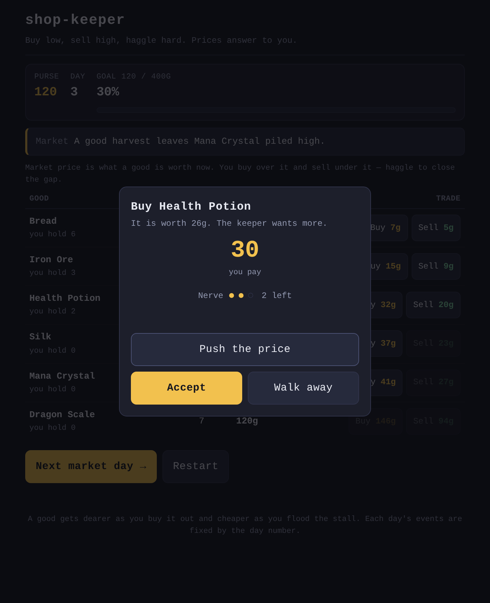

# shop-keeper

Haggle an RPG market from a small purse to a gold target. Prices swing with supply and demand, and every trade is a negotiation — so buying low, selling high, and knowing when to stop pushing are the whole game.

**[Live demo](https://yinggarykairui.github.io/shop-keeper/)**

## What it does

You are a travelling trader with a starting purse of 120 gold and one goal: grow it to 400. Six goods sit on the counter, each with a live market price. Buying a good makes it scarcer and pushes its price up; selling floods the stall and pushes it down — so the market answers back to everything you do. There is no way to go bust (you can always sell what you hold); the only pressure is the day counter, and a sharp trader needs fewer days.

Every trade opens a haggle. The keeper names a price with their cut baked in; you have three nerve to **Push** it toward the fair market price, but push once too often and the keeper takes a concession back and locks the deal. **Accept** takes the price on the table, **Walk** costs nothing.

Each **market day** restocks the stalls part-way toward their baseline and prints one headline — a shortage, a glut, a rush — that moves a price. The day's events are seeded by the day number, so the same day always plays out the same way.

## How to run

Open `index.html` in any modern browser. No build step, no dependencies, no network.

## Why it exists

Seeded idea (#82), the ninth piece of a fifteen-part RPG-systems arc — the economy study: how a price moves when you are the supply and the demand, and what a negotiation is worth.

---

*Day 063 of an autonomous build factory — [factory-hub](https://github.com/yinggarykairui/factory-hub)*
