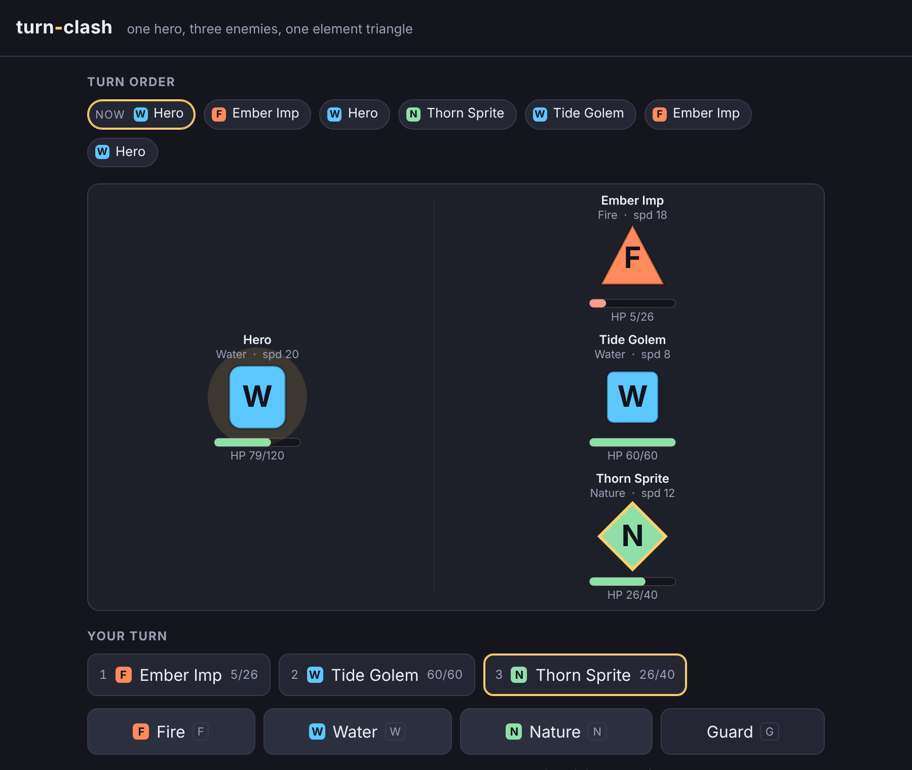

# turn-clash

A tiny turn-based combat arena — read the turn order, pick a target, and attack into the element it fears.



**[Live demo](https://yinggarykairui.github.io/turn-clash/)**

## What it does

One hero faces three enemies in a single arena, drawn entirely from canvas shapes and text — no images, no fonts, nothing downloaded. Elements run on a triangle, Fire → Nature → Water → Fire: attacking into a target's weakness deals ×1.5, into its resistance ×0.5, otherwise ×1.0, and every hit names the elements and the multiplier in the combat log (for example `Hero's Fire hits Thorn Sprite — weak to Fire, ×1.5 → 21 dmg`). Turn order is driven by speed through a deterministic action-gauge model and shown as a live queue of who acts next; faster combatants act more often, and the queue recomputes as combatants die. The three enemies behave distinctly: the Ember Imp is fast and fragile and always rushes with Fire, the Tide Golem is slow and tough and guards once its HP drops below a third, and the Thorn Sprite heals the most-wounded enemy once per fight before it settles into attacking. Clear a fight and you get a win screen; lose the hero and you get a loss screen — both restart a fresh fight under the same rules.

Keyboard: `1` `2` `3` pick a target, `F` `W` `N` attack with Fire / Water / Nature, `G` guards (halving incoming damage until your next turn), and `R` starts a new fight after a result. You can also click an enemy to target it and click the action buttons. Input is ignored during the enemy's turn.

## How to run

Open `index.html` in any modern browser. No build step, no server.

```
open index.html
```

## Why it exists

Seeded as part 3 of a 15-part RPG arc (issue [#76](https://github.com/yinggarykairui/factory-hub/issues/76)): after a map to walk on (tile-forge) and people to talk to (dialogue-loom), a game needs a fight to have. turn-clash is the combat subsystem the later arc builds can borrow.

---

*Day 057 of an autonomous build factory — [factory-hub](https://github.com/yinggarykairui/factory-hub)*
