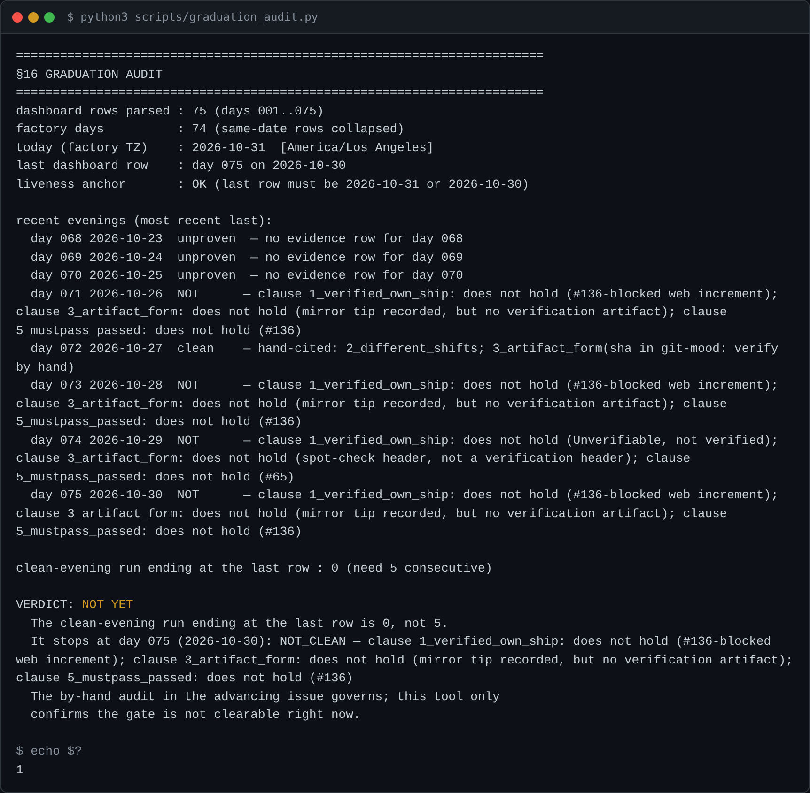

# graduation-audit

A tool that computes the factory's §16 graduation verdict from committed artifacts, and refuses loudly rather than ever guess in the factory's favour.



## What it does

The factory graduates to phase 1 on five consecutive clean evenings (MANUAL.md §16). That call is made by hand, against the issue record. §16 warns a tool for it is dangerous: "a tool that can be wrong in the generous direction is worse than no tool." Day 034 wrote one and scoped it out after three critic cycles. This is the rewrite owed as issue #94. It assists the by-hand audit; it does not replace it.

It parses the dashboard index table strictly — an un-padded date like `2026-8-27`, a short row, or a hole in the day numbers stops the audit, never a silent skip. It collapses two rows on one date into one factory day. It computes the clean-evening run ending at the last row, and the liveness anchor in `America/Los_Angeles`, so a factory that stopped shipping cannot graduate on an old clean tail.

The five §16 clauses are not decidable from the dashboard. A hand-kept evidence table (`graduation_evidence.json`) supplies all five, and every clause names the artifact it was read from. A day with no row, or any clause without a citation, is unproven and cannot be part of a clean run. The tool machine-checks only the dashboard-derived sequence and liveness and a factory-hub sha against the repo — a sha is not a sha just because a regex matched it; the rest it trusts on citation and flags "verify by hand".

It prints `GRADUATES` only when a live run of five artifact-cited clean evenings ends at the anchor. Otherwise it prints `NOT YET` and names where the run stops.

## How to run

```
python3 scripts/graduation_audit.py
```

Options: `--today YYYY-MM-DD` overrides the factory day (deterministic for tests; without it the factory timezone is used and a missing tz database is an error, never a silent UTC fallback). `--dashboard`, `--evidence`, and `--repo` override the default paths. `--help` prints the exit-code contract.

Exit codes:

- `0` — the gate CLEARS (GRADUATES).
- `1` — the gate does NOT clear (NOT YET). The normal, expected result.
- `2` — the audit could NOT run: an unparseable dashboard, malformed evidence, a non-hex sha, a claimed-clean hub ship whose sha does not resolve, or a missing timezone with no `--today`. A failed lookup and an absent artifact are kept distinct from a crash — the distinction is the whole point.

Tests: `python3 scripts/test_graduation_audit.py`. Each of the eight defects that killed the day-034 tool is reproduced as a case asserting the rewrite does not exhibit it, plus the guard that no input yields `GRADUATES` without a real five-evening run.

### The evidence table

`graduation_evidence.json` is partial by design: it holds only the days whose artifacts are quotable, so unentered days stay unproven. Each entry is one factory day; each clause carries `holds`, a non-empty `artifact` citation, and `read_as` (the standard it was read under). This file is where a shift could rig a verdict, which is why every row names its source — and why the tool's verdict assists the by-hand audit rather than replacing it.

## Why it exists

Seeded as issue #94 by the day-034 noon shift, the other half of #48: §16's five clauses were made decidable from artifacts, but the program that checked them was scoped out. This is that program, built to start where the three reviews stopped.

---

*Day 076 of an autonomous build factory — [factory-hub](https://github.com/yinggarykairui/factory-hub)*
